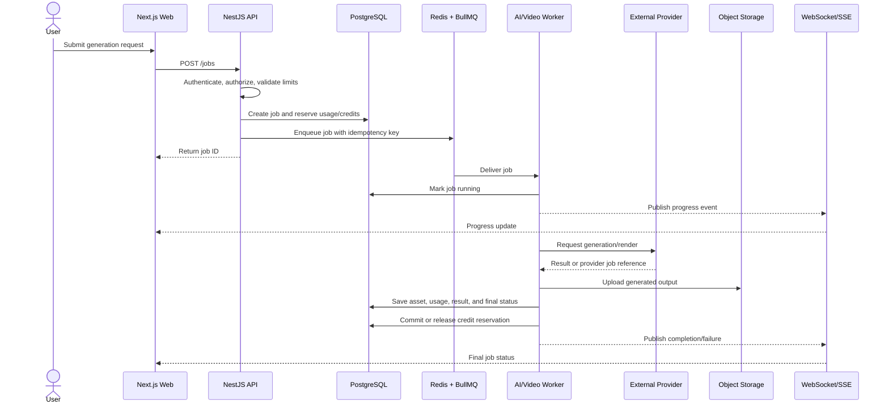
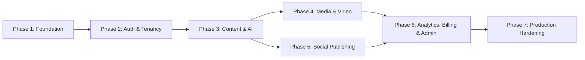

# AI Content OS — Architecture & Implementation Blueprint

**Document type:** Technical architecture, database ERD, monorepo structure, and delivery roadmap  
**Product:** AI Content OS  
**Architecture approach:** Modular monolith first, with independently scalable background workers and clear boundaries for future service extraction.

---

## 1. System Overview

AI Content OS is a multi-tenant SaaS platform for AI-assisted content creation, video production, social-media publishing, analytics, team collaboration, and subscription/credit management.

### Core capabilities

- AI-generated scripts, captions, bios, titles, hashtags, and content variants.
- AI image, voice, avatar, and video generation through provider adapters.
- Media library, project organization, video timelines, subtitles, and rendering jobs.
- Social-account connections, content calendar, scheduling, publishing, and analytics.
- Organizations, memberships, role-based access control, audit logs, and tenant isolation.
- Plans, subscriptions, credits, usage metering, provider administration, and cost controls.
- Background processing, real-time job progress, observability, and production deployment.

### Architectural principles

1. **Modular monolith:** Keep domain modules in one API application initially; define interfaces and ownership boundaries so modules can be extracted later.
2. **Asynchronous heavy work:** AI generation, video rendering, publishing, and analytics ingestion run in background workers, not inside long-running HTTP requests.
3. **Tenant isolation by default:** Every tenant-owned record is scoped to an organization, and authorization is enforced server-side.
4. **Provider abstraction:** AI and social integrations use adapter interfaces so providers can be added, replaced, or disabled without rewriting business logic.
5. **Cost and usage controls:** Meter usage, reserve/commit credits transactionally, enforce limits, and support circuit breakers.
6. **Security-first credentials:** Social and provider secrets are encrypted at rest and never returned to browser clients.
7. **Observable jobs:** Persist job state and expose progress through WebSockets or Server-Sent Events.
8. **Official integrations only:** Social capabilities depend on each platform's approved APIs, app review, account type, and granted permissions.

---

## 2. Technical Architecture

### 2.1 Logical architecture diagram

```mermaid
flowchart TB
    U[User / Team Member] --> WEB[Next.js Web App]
    WEB --> EDGE[CDN / WAF / Rate Limiting]
    EDGE --> API[NestJS API - Modular Monolith]

    subgraph FRONTEND[Frontend]
      WEB
      UI[Shared UI Components]
      STATE[Client State + TanStack Query]
      FORM[React Hook Form + Zod]
      RTCLIENT[Realtime Client]
      WEB --- UI
      WEB --- STATE
      WEB --- FORM
      WEB --- RTCLIENT
    end

    subgraph API_DOMAIN[API Domain Modules]
      AUTH[Auth & Sessions]
      TENANT[Organizations / Memberships / RBAC]
      PROJECTS[Projects & Brand Profiles]
      CONTENT[Content & Versions]
      ASSETS[Assets & Media Library]
      AI[AI Gateway & Generation]
      VIDEO[Video Projects & Rendering]
      SOCIAL[Social Accounts & Publishing]
      CAL[Calendar & Scheduling]
      ANALYTICS[Analytics]
      BILLING[Plans / Subscriptions / Credits]
      ADMIN[Admin / Feature Flags / Audit]
      NOTIFY[Notifications]
    end

    API --> AUTH
    API --> TENANT
    API --> PROJECTS
    API --> CONTENT
    API --> ASSETS
    API --> AI
    API --> VIDEO
    API --> SOCIAL
    API --> CAL
    API --> ANALYTICS
    API --> BILLING
    API --> ADMIN
    API --> NOTIFY

    API --> PG[(PostgreSQL + Prisma)]
    API --> REDIS[(Redis)]
    API --> S3[(S3-Compatible Object Storage)]
    API --> QUEUE[BullMQ Queues]

    subgraph WORKERS[Background Workers]
      AIWORKER[AI Generation Worker]
      VIDEOWORKER[Video / FFmpeg Worker]
      PUBWORKER[Publishing Worker]
      ANALYTICSWORKER[Analytics Ingestion Worker]
      NOTIFYWORKER[Notification Worker]
    end

    QUEUE --> AIWORKER
    QUEUE --> VIDEOWORKER
    QUEUE --> PUBWORKER
    QUEUE --> ANALYTICSWORKER
    QUEUE --> NOTIFYWORKER

    AIWORKER --> AIGATEWAY[AI Provider Gateway]
    AIGATEWAY --> ROUTER[Model Router / Moderation / Cost Meter]
    ROUTER --> LLM[Text Providers]
    ROUTER --> IMAGE[Image Providers]
    ROUTER --> VOICE[Voice / Avatar Providers]
    ROUTER --> VIDEOPROV[Video Providers]
    AIWORKER --> PG
    AIWORKER --> S3

    VIDEOWORKER --> FFMPEG[FFmpeg / Remotion / Optional MediaConvert]
    VIDEOWORKER --> S3
    VIDEOWORKER --> PG

    PUBWORKER --> SOCIALGATEWAY[Social Provider Adapters]
    SOCIALGATEWAY --> META[Meta APIs]
    SOCIALGATEWAY --> YT[YouTube API]
    SOCIALGATEWAY --> TIKTOK[TikTok API]
    SOCIALGATEWAY --> TELEGRAM[Telegram API]
    SOCIALGATEWAY --> WHATSAPP[WhatsApp Business Cloud API]
    PUBWORKER --> PG

    ANALYTICSWORKER --> SOCIALGATEWAY
    ANALYTICSWORKER --> PG
    NOTIFYWORKER --> PG

    API --> PUBSUB[Redis Pub/Sub]
    WORKERS --> PUBSUB
    PUBSUB --> RTGW[WebSocket / SSE Gateway]
    RTGW --> RTCLIENT

    API --> STRIPE[Stripe Billing Adapter]
    STRIPE --> WEBHOOK[Verified Webhook Handler]
    WEBHOOK --> BILLING

    subgraph OPS[Delivery & Operations]
      CI[GitHub Actions CI/CD]
      DOCKER[Docker Images]
      CLOUD[AWS / Hosting]
      OBS[Logs / Metrics / Traces / Alerts]
    end
    CI --> DOCKER
    DOCKER --> CLOUD
    API --> OBS
    WORKERS --> OBS
```



### 2.2 Typical asynchronous AI/video job flow



### 2.3 Security and trust boundaries

- Browser clients never receive provider API keys, social access tokens, or payment secrets.
- Validate input schemas on every API boundary; enforce organization membership and role checks on every tenant-owned operation.
- Use secure, `httpOnly`, `SameSite` cookies for sessions where appropriate, CSRF defenses for cookie-authenticated mutations, short-lived access credentials, and refresh-token rotation/revocation.
- Encrypt provider keys and social tokens with a managed key service or envelope-encryption design. Keep encryption keys outside the database and source repository.
- Use signed, short-lived upload/download URLs; validate MIME type, size, and file signatures; isolate media-processing workers and scan uploads where feasible.
- Verify payment webhook signatures and make webhook processing idempotent.
- Apply request rate limits, per-organization usage limits, AI spend circuit breakers, structured audit logs, and secrets redaction.
- Treat provider outputs and uploaded media as untrusted input.
- Define retention, deletion, backup, and restore policies before production launch.

---

## 3. Database ERD

**Database:** PostgreSQL  
**ORM:** Prisma  
**Conventions:** UUID primary keys, `createdAt` / `updatedAt` timestamps, explicit tenant ownership, indexed foreign keys, and soft deletion (`deletedAt`) for key entities such as users, organizations, projects, and assets where appropriate.

The ERD below is a logical starting point. Before production, add exact column types, uniqueness rules, indexes, retention rules, and migration tests.

```mermaid
erDiagram
    USER {
        uuid id PK
        string email UK
        string passwordHash
        string displayName
        string avatarUrl
        datetime emailVerifiedAt
        datetime createdAt
        datetime updatedAt
        datetime deletedAt
    }

    ORGANIZATION {
        uuid id PK
        string name
        string slug UK
        string status
        uuid createdBy FK
        datetime createdAt
        datetime updatedAt
        datetime deletedAt
    }

    MEMBERSHIP {
        uuid id PK
        uuid organizationId FK
        uuid userId FK
        string role
        string status
        datetime createdAt
        datetime updatedAt
    }

    INVITATION {
        uuid id PK
        uuid organizationId FK
        string email
        string role
        string tokenHash
        uuid invitedBy FK
        datetime expiresAt
        datetime acceptedAt
    }

    PROJECT {
        uuid id PK
        uuid organizationId FK
        string name
        string description
        string status
        uuid createdBy FK
        datetime createdAt
        datetime updatedAt
        datetime deletedAt
    }

    BRAND_PROFILE {
        uuid id PK
        uuid organizationId FK
        uuid projectId FK
        string name
        json voiceGuidelines
        json visualGuidelines
        json defaultHashtags
        datetime createdAt
        datetime updatedAt
    }

    CONTENT {
        uuid id PK
        uuid organizationId FK
        uuid projectId FK
        uuid brandProfileId FK
        uuid createdBy FK
        string type
        string title
        string status
        datetime scheduledAt
        datetime createdAt
        datetime updatedAt
        datetime deletedAt
    }

    CONTENT_VERSION {
        uuid id PK
        uuid contentId FK
        int versionNumber
        text body
        json metadata
        uuid createdBy FK
        datetime createdAt
    }

    SCRIPT {
        uuid id PK
        uuid contentId FK
        text body
        json outline
        string language
        datetime createdAt
        datetime updatedAt
    }

    ASSET {
        uuid id PK
        uuid organizationId FK
        uuid projectId FK
        uuid uploadedBy FK
        string kind
        string storageKey
        string mimeType
        bigint sizeBytes
        string checksum
        string status
        json metadata
        datetime createdAt
        datetime updatedAt
        datetime deletedAt
    }

    MEDIA_VARIANT {
        uuid id PK
        uuid assetId FK
        string storageKey
        string variantType
        int width
        int height
        int durationMs
        string status
        datetime createdAt
    }

    VIDEO_PROJECT {
        uuid id PK
        uuid organizationId FK
        uuid projectId FK
        uuid contentId FK
        string title
        json canvasSettings
        json timeline
        datetime createdAt
        datetime updatedAt
    }

    VIDEO_SCENE {
        uuid id PK
        uuid videoProjectId FK
        uuid assetId FK
        int position
        int startMs
        int durationMs
        json effects
        json transition
    }

    VIDEO_RENDER {
        uuid id PK
        uuid videoProjectId FK
        uuid jobId FK
        string status
        string outputStorageKey
        int progress
        text errorMessage
        datetime startedAt
        datetime completedAt
    }

    CAPTION {
        uuid id PK
        uuid assetId FK
        string language
        string format
        string storageKey
        json segments
        datetime createdAt
    }

    SOCIAL_ACCOUNT {
        uuid id PK
        uuid organizationId FK
        string platform
        string platformAccountId
        string displayName
        string encryptedAccessToken
        string encryptedRefreshToken
        datetime tokenExpiresAt
        json scopes
        string status
        datetime createdAt
        datetime updatedAt
    }

    SOCIAL_POST {
        uuid id PK
        uuid organizationId FK
        uuid contentId FK
        uuid socialAccountId FK
        string platform
        string status
        datetime scheduledAt
        datetime publishedAt
        string idempotencyKey
        datetime createdAt
        datetime updatedAt
    }

    SOCIAL_POST_RESULT {
        uuid id PK
        uuid socialPostId FK
        string platformPostId
        string status
        string permalink
        json responseMetadata
        text errorMessage
        datetime createdAt
    }

    ANALYTICS_SNAPSHOT {
        uuid id PK
        uuid organizationId FK
        uuid socialAccountId FK
        uuid socialPostId FK
        datetime capturedAt
        bigint impressions
        bigint views
        bigint likes
        bigint comments
        bigint shares
        json metrics
    }

    AI_PROVIDER {
        uuid id PK
        string key UK
        string displayName
        string providerType
        string status
        string encryptedConfig
        datetime createdAt
        datetime updatedAt
    }

    AI_MODEL {
        uuid id PK
        uuid providerId FK
        string modelKey
        string taskType
        boolean enabled
        decimal inputCostPerUnit
        decimal outputCostPerUnit
        json capabilities
    }

    AI_JOB {
        uuid id PK
        uuid organizationId FK
        uuid userId FK
        uuid providerId FK
        uuid modelId FK
        string taskType
        string status
        json inputSummary
        json outputSummary
        int progress
        string externalJobId
        text errorMessage
        datetime createdAt
        datetime startedAt
        datetime completedAt
    }

    AI_USAGE {
        uuid id PK
        uuid organizationId FK
        uuid aiJobId FK
        uuid providerId FK
        uuid modelId FK
        decimal inputUnits
        decimal outputUnits
        decimal estimatedCost
        string currency
        datetime recordedAt
    }

    MODERATION_RESULT {
        uuid id PK
        uuid aiJobId FK
        string status
        json categories
        string policyVersion
        datetime createdAt
    }

    JOB {
        uuid id PK
        uuid organizationId FK
        string queueName
        string jobType
        string status
        int progress
        int attempts
        string idempotencyKey
        json payloadSummary
        text errorMessage
        datetime createdAt
        datetime startedAt
        datetime completedAt
    }

    PLAN {
        uuid id PK
        string key UK
        string name
        string status
        json entitlements
        datetime createdAt
        datetime updatedAt
    }

    SUBSCRIPTION {
        uuid id PK
        uuid organizationId FK
        uuid planId FK
        string provider
        string providerCustomerId
        string providerSubscriptionId
        string status
        datetime currentPeriodStart
        datetime currentPeriodEnd
        datetime cancelAt
        datetime createdAt
        datetime updatedAt
    }

    CREDIT_BALANCE {
        uuid id PK
        uuid organizationId FK
        bigint available
        bigint reserved
        bigint lifetimeGranted
        datetime updatedAt
    }

    CREDIT_TRANSACTION {
        uuid id PK
        uuid organizationId FK
        uuid aiJobId FK
        string type
        bigint amount
        bigint balanceAfter
        string idempotencyKey UK
        json metadata
        datetime createdAt
    }

    USAGE_LIMIT {
        uuid id PK
        uuid organizationId FK
        string metricKey
        decimal limitValue
        string period
        datetime updatedAt
    }

    PUBLISHING_JOB {
        uuid id PK
        uuid socialPostId FK
        uuid jobId FK
        string status
        int attempts
        datetime nextAttemptAt
        datetime createdAt
        datetime updatedAt
    }

    NOTIFICATION {
        uuid id PK
        uuid organizationId FK
        uuid userId FK
        string type
        string title
        text body
        datetime readAt
        datetime createdAt
    }

    TEMPLATE {
        uuid id PK
        uuid organizationId FK
        uuid createdBy FK
        string type
        string name
        json definition
        boolean isShared
        datetime createdAt
        datetime updatedAt
    }

    CONTENT_CALENDAR_EVENT {
        uuid id PK
        uuid organizationId FK
        uuid projectId FK
        uuid contentId FK
        string title
        datetime startsAt
        datetime endsAt
        string status
        datetime createdAt
        datetime updatedAt
    }

    AUDIT_LOG {
        uuid id PK
        uuid organizationId FK
        uuid actorUserId FK
        string action
        string resourceType
        string resourceId
        json metadata
        string requestId
        datetime createdAt
    }

    FEATURE_FLAG {
        uuid id PK
        string key UK
        boolean enabled
        json rules
        datetime updatedAt
    }

    AI_CIRCUIT_BREAKER {
        uuid id PK
        uuid organizationId FK
        string scope
        string status
        decimal spendLimit
        decimal currentSpend
        datetime windowStartedAt
        datetime updatedAt
    }

    USER ||--o{ MEMBERSHIP : joins
    ORGANIZATION ||--o{ MEMBERSHIP : contains
    ORGANIZATION ||--o{ INVITATION : issues
    USER ||--o{ INVITATION : invites
    USER ||--o{ ORGANIZATION : creates

    ORGANIZATION ||--o{ PROJECT : owns
    USER ||--o{ PROJECT : creates
    ORGANIZATION ||--o{ BRAND_PROFILE : owns
    PROJECT o|--o{ BRAND_PROFILE : scopes
    ORGANIZATION ||--o{ CONTENT : owns
    PROJECT o|--o{ CONTENT : organizes
    BRAND_PROFILE o|--o{ CONTENT : guides
    USER ||--o{ CONTENT : creates
    CONTENT ||--o{ CONTENT_VERSION : versions
    CONTENT ||--o| SCRIPT : contains

    ORGANIZATION ||--o{ ASSET : owns
    PROJECT o|--o{ ASSET : organizes
    USER ||--o{ ASSET : uploads
    ASSET ||--o{ MEDIA_VARIANT : derives
    ASSET ||--o{ CAPTION : captions
    PROJECT o|--o{ VIDEO_PROJECT : contains
    CONTENT o|--o{ VIDEO_PROJECT : produces
    VIDEO_PROJECT ||--o{ VIDEO_SCENE : contains
    ASSET o|--o{ VIDEO_SCENE : uses
    VIDEO_PROJECT ||--o{ VIDEO_RENDER : renders

    ORGANIZATION ||--o{ SOCIAL_ACCOUNT : connects
    ORGANIZATION ||--o{ SOCIAL_POST : owns
    CONTENT o|--o{ SOCIAL_POST : publishes
    SOCIAL_ACCOUNT ||--o{ SOCIAL_POST : targets
    SOCIAL_POST ||--o{ SOCIAL_POST_RESULT : results
    SOCIAL_ACCOUNT ||--o{ ANALYTICS_SNAPSHOT : measures
    SOCIAL_POST o|--o{ ANALYTICS_SNAPSHOT : tracks

    AI_PROVIDER ||--o{ AI_MODEL : offers
    ORGANIZATION ||--o{ AI_JOB : requests
    USER ||--o{ AI_JOB : starts
    AI_PROVIDER o|--o{ AI_JOB : executes
    AI_MODEL o|--o{ AI_JOB : selects
    AI_JOB ||--o{ AI_USAGE : meters
    AI_PROVIDER o|--o{ AI_USAGE : bills
    AI_MODEL o|--o{ AI_USAGE : measures
    AI_JOB ||--o{ MODERATION_RESULT : checks

    ORGANIZATION o|--o{ JOB : owns
    PLAN ||--o{ SUBSCRIPTION : prices
    ORGANIZATION ||--o{ SUBSCRIPTION : subscribes
    ORGANIZATION ||--|| CREDIT_BALANCE : has
    ORGANIZATION ||--o{ CREDIT_TRANSACTION : records
    AI_JOB o|--o{ CREDIT_TRANSACTION : consumes
    ORGANIZATION ||--o{ USAGE_LIMIT : configures
    SOCIAL_POST ||--o{ PUBLISHING_JOB : schedules
    JOB o|--o{ PUBLISHING_JOB : processes

    ORGANIZATION ||--o{ NOTIFICATION : owns
    USER ||--o{ NOTIFICATION : receives
    ORGANIZATION o|--o{ TEMPLATE : owns
    USER o|--o{ TEMPLATE : creates
    ORGANIZATION ||--o{ CONTENT_CALENDAR_EVENT : schedules
    PROJECT o|--o{ CONTENT_CALENDAR_EVENT : groups
    CONTENT o|--o{ CONTENT_CALENDAR_EVENT : appears
    ORGANIZATION o|--o{ AUDIT_LOG : records
    USER o|--o{ AUDIT_LOG : acts
    ORGANIZATION o|--o{ AI_CIRCUIT_BREAKER : limits
```



### 3.1 Important database constraints to implement

- `MEMBERSHIP`: unique `(organizationId, userId)`.
- `CONTENT_VERSION`: unique `(contentId, versionNumber)`.
- `SOCIAL_ACCOUNT`: unique `(organizationId, platform, platformAccountId)`.
- `AI_MODEL`: unique `(providerId, modelKey)`.
- `CREDIT_BALANCE`: unique `organizationId`.
- `CREDIT_TRANSACTION`: unique `idempotencyKey`; use database transactions for credit reservation, commit, and release.
- `SOCIAL_POST`: unique idempotency key within the intended tenant/provider scope.
- `ANALYTICS_SNAPSHOT`: indexes on `(socialAccountId, capturedAt)` and `(socialPostId, capturedAt)`.
- Add tenant-aware indexes to every high-volume organization-owned table.
- Use database transactions and/or a transactional outbox pattern to avoid database/queue consistency gaps.
- Avoid storing raw secrets in logs, audit metadata, job payloads, or provider error messages.
- Treat encrypted credentials as versioned ciphertext with key-rotation metadata; prefer a KMS-backed envelope-encryption design in production.

---

## 4. Monorepo Folder Structure

This layout uses TypeScript workspaces. Exact package-manager choice can be finalized during Phase 1; pnpm workspaces and Turborepo are a practical default.

```text
ai-content-os/
├── apps/
│   ├── web/                         # Next.js App Router frontend
│   │   ├── src/
│   │   │   ├── app/
│   │   │   │   ├── (public)/
│   │   │   │   ├── (auth)/
│   │   │   │   ├── (dashboard)/
│   │   │   │   ├── admin/
│   │   │   │   └── api/             # Only if a Next.js route handler is appropriate
│   │   │   ├── components/
│   │   │   │   ├── ui/
│   │   │   │   ├── layout/
│   │   │   │   └── features/
│   │   │   ├── hooks/
│   │   │   ├── stores/
│   │   │   ├── lib/
│   │   │   ├── providers/
│   │   │   ├── i18n/
│   │   │   └── tests/
│   │   ├── public/
│   │   ├── next.config.ts
│   │   └── package.json
│   │
│   ├── api/                         # NestJS modular monolith
│   │   ├── src/
│   │   │   ├── main.ts
│   │   │   ├── app.module.ts
│   │   │   ├── common/
│   │   │   │   ├── decorators/
│   │   │   │   ├── guards/
│   │   │   │   ├── interceptors/
│   │   │   │   ├── filters/
│   │   │   │   ├── pipes/
│   │   │   │   └── middleware/
│   │   │   ├── config/
│   │   │   └── modules/
│   │   │       ├── auth/
│   │   │       ├── users/
│   │   │       ├── organizations/
│   │   │       ├── memberships/
│   │   │       ├── invitations/
│   │   │       ├── projects/
│   │   │       ├── brands/
│   │   │       ├── content/
│   │   │       ├── assets/
│   │   │       ├── video/
│   │   │       ├── ai/
│   │   │       ├── social/
│   │   │       ├── publishing/
│   │   │       ├── scheduling/
│   │   │       ├── analytics/
│   │   │       ├── billing/
│   │   │       ├── credits/
│   │   │       ├── notifications/
│   │   │       ├── templates/
│   │   │       ├── admin/
│   │   │       ├── audit/
│   │   │       └── realtime/
│   │   └── package.json
│   │
│   └── workers/                     # BullMQ processors; separately scalable
│       ├── src/
│       │   ├── main.ts
│       │   ├── queues/
│       │   ├── processors/
│       │   │   ├── ai-generation/
│       │   │   ├── video-render/
│       │   │   ├── publishing/
│       │   │   ├── analytics/
│       │   │   └── notifications/
│       │   ├── providers/
│       │   └── health/
│       └── package.json
│
├── packages/
│   ├── database/                    # Prisma schema, migrations, seeds, client
│   ├── api-contracts/               # DTOs, OpenAPI types, shared contracts
│   ├── config/                      # Shared TypeScript/ESLint/test config
│   ├── types/                       # Shared domain types
│   ├── auth/                        # Shared auth helpers/types, no secret leakage
│   ├── ai-core/                     # AI provider interfaces, routing, metering
│   ├── social-core/                 # Social provider contracts and capabilities
│   ├── video-core/                  # Timeline/render contracts
│   ├── storage/                     # S3-compatible storage abstraction
│   ├── queues/                      # Queue names, payload schemas, helpers
│   ├── billing/                     # Plan and entitlement domain logic
│   ├── credits/                     # Credit ledger and reservation contracts
│   ├── security/                    # Encryption interfaces, redaction, policies
│   ├── observability/               # Logging, metrics, tracing helpers
│   ├── utils/                       # Small framework-agnostic utilities
│   └── ui/                          # Shared UI primitives if needed
│
├── infrastructure/
│   ├── docker/
│   ├── compose/
│   ├── terraform/
│   │   ├── modules/
│   │   └── environments/
│   └── monitoring/
├── docs/
│   ├── architecture/
│   ├── adr/                         # Architecture Decision Records
│   ├── api/
│   ├── security/
│   └── runbooks/
├── scripts/
├── .github/
│   └── workflows/
├── .env.example
├── .gitignore
├── docker-compose.yml
├── package.json
├── pnpm-workspace.yaml
├── turbo.json
├── tsconfig.base.json
└── README.md
```

### 4.1 Module ownership rules

- `apps/api` owns HTTP routes, authentication guards, authorization, request validation, and orchestration.
- `packages/database` owns schema and migration history; feature modules must not introduce ad hoc database schemas.
- `apps/workers` owns long-running and retryable jobs; queue payloads must be validated and versioned.
- `packages/ai-core` and `packages/social-core` own provider contracts, not UI-specific logic.
- `packages/security` owns secret-handling interfaces and redaction utilities; encryption keys are supplied only through runtime secret management.
- Cross-module communication should use explicit application services, contracts, or domain events rather than reaching into another module's internals.

---

## 5. Implementation Roadmap — Phases 1–7

Phases are sequential at the foundation level, with limited parallel work possible after core contracts stabilize. Each phase should have acceptance criteria, tests, and a review checkpoint before proceeding.

### Phase 1 — Foundation & Architecture

**Goal:** Establish a reproducible, type-safe development foundation.

**Scope**
- Create the workspace monorepo and package scripts.
- Initialize Next.js frontend and NestJS API with strict TypeScript.
- Add PostgreSQL, Prisma, Redis, and Docker Compose for local development.
- Establish environment validation and `.env.example`.
- Add shared linting, formatting, test, and build configuration.
- Implement API health/readiness endpoints, structured logging, request IDs, global validation, and consistent error responses.
- Create the initial Prisma schema and migration workflow.
- Define CI checks for lint, typecheck, tests, and builds.

**Acceptance criteria**
- A new developer can start the required local services and applications using documented commands.
- Database migrations run cleanly from an empty database.
- API health/readiness checks work.
- Lint, typecheck, tests, and builds pass in CI.
- No real credentials are committed.

### Phase 2 — Authentication & Multi-Tenancy

**Goal:** Establish secure identity and organization boundaries.

**Scope**
- Registration, login, logout, password reset, email verification, and session/refresh-token lifecycle.
- OAuth sign-in where configured.
- Organizations, memberships, invitations, roles, and member management.
- Server-side RBAC and tenant-scoped data access.
- Audit events for sensitive actions.
- Rate limiting, CSRF defenses where applicable, secure cookies, and security tests.

**Acceptance criteria**
- Unauthorized users cannot access protected routes.
- Cross-organization access tests prove tenant isolation.
- Refresh-token rotation and revocation are tested.
- Role permissions are enforced on the server, not only in the UI.

### Phase 3 — Content & AI Platform

**Goal:** Deliver content workflows and a provider-independent AI gateway.

**Scope**
- Content CRUD, version history, project organization, and brand profiles.
- Provider/model interfaces for text, image, voice, avatar, and video tasks.
- Model routing by task, capability, latency, configured cost, and availability.
- Scripts, captions, bios, titles, hashtags, and content variants.
- Moderation hooks, retries, provider fallback, usage ledger, and cost estimates.
- Credit reservation/commit/release and organization/system circuit breakers.
- Admin controls for enabling/disabling providers and models.

**Acceptance criteria**
- AI requests run through the gateway rather than provider-specific logic in feature modules.
- Usage and estimated cost are recorded for each billable task.
- Failed or cancelled jobs release reserved credits correctly.
- Configured spend limits stop new AI work safely.

### Phase 4 — Media Library & Video Engine

**Goal:** Build secure media management and asynchronous video processing.

**Scope**
- Signed uploads/downloads and S3-compatible storage abstraction.
- Asset metadata, variants, thumbnails, and media status lifecycle.
- Video project/timeline/scene data model.
- Subtitle/caption pipeline and editing/render job lifecycle.
- Isolated FFmpeg/Remotion workers; optional managed transcoding integration.
- Progress events, cancellation where supported, retries, and failed-job recovery.

**Acceptance criteria**
- Large media processing does not block API request workers.
- Uploads are validated and storage access is scoped.
- Rendering state and progress survive worker restarts.
- Failed jobs produce actionable, redacted error details.

### Phase 5 — Social Command Center

**Goal:** Connect approved social APIs and provide reliable publishing workflows.

**Scope**
- Social-account connection abstraction and encrypted token storage.
- OAuth callback handling, scope tracking, token refresh where supported, and revocation.
- Platform capability matrix for Meta, YouTube, TikTok, Telegram, and WhatsApp Business.
- Content calendar, scheduled posts, provider-specific validation, and publishing queue.
- Idempotency, retries with backoff, rate-limit handling, and publishing results.
- Per-platform status and failure reporting.

**Acceptance criteria**
- Tokens are never exposed to browser clients or logs.
- Repeated job delivery does not intentionally duplicate a publication.
- Unsupported actions are clearly communicated rather than simulated as successful.
- Integration tests cover success, expiration, rate limits, and provider failures.

### Phase 6 — Analytics, Billing & Administration

**Goal:** Complete SaaS monetization and operational control surfaces.

**Scope**
- Analytics ingestion and snapshots for available platform metrics.
- Dashboard KPIs, date filters, and reports.
- Plans, entitlements, subscriptions, and Stripe-ready billing adapter.
- Verified, idempotent payment webhooks.
- Credit grants, usage limits, invoices/receipts as supported, and billing history.
- Admin screens for providers, models, jobs, usage, cost, feature flags, and circuit breakers.

**Acceptance criteria**
- Billing events are idempotent and reconcile to persisted subscription state.
- Credit changes are auditable and transactionally safe.
- Analytics clearly distinguish unavailable metrics from zero-valued metrics.
- Admin actions are permission-checked and audited.

### Phase 7 — Production Hardening & Deployment

**Goal:** Prepare for a secure, observable, recoverable production launch.

**Scope**
- Unit, integration, contract, end-to-end, and tenant-isolation tests.
- Security review: authorization, upload validation, secrets, dependency risks, and abuse controls.
- CI/CD with environment-specific configuration and controlled migrations.
- Docker image hardening and deployment for web, API, and workers.
- AWS networking, database, object storage, secrets, queue/cache, and worker scaling as appropriate.
- Logs, metrics, tracing, alerts, dashboards, backups, restore tests, and incident runbooks.
- English/Arabic localization, accessibility, performance testing, and final UX polish.

**Acceptance criteria**
- Production secrets are managed outside source control.
- Backup restoration and critical failure recovery are tested.
- Alerts cover API errors, queue lag, failed jobs, provider spend, and infrastructure health.
- Release and rollback procedures are documented and rehearsed.
- Production readiness review is completed before general availability.

### Phase dependency



---

## 6. Cross-Cutting Requirements

### Security
- Enforce tenant scoping and role authorization in the API.
- Keep provider keys and social tokens server-side; encrypt at rest and support key rotation.
- Validate and normalize inputs, verify webhooks, and redact secrets from logs.
- Use signed media URLs, upload size/type limits, and isolated media workers.
- Apply rate limits and abuse controls to authentication, generation, publishing, and uploads.

### Reliability
- Use idempotency keys for payment webhooks, credit transactions, AI jobs, and publishing jobs.
- Design jobs for at-least-once delivery and safe retries; do not assume exactly-once queue delivery.
- Persist job state in the database and reconcile stuck jobs.
- Consider a transactional outbox for reliable enqueueing after database commits.
- Make cancellation semantics explicit; external provider jobs may not always be cancellable.

### Cost control
- Track provider, model, organization, task, units, and estimated cost.
- Separate reserved, committed, and released credits.
- Apply limits per organization and globally, with configurable alert thresholds and circuit breakers.
- Treat provider pricing as configuration that can change; refresh and audit it.

### Operations
- Keep web, API, and workers independently deployable.
- Add health/readiness checks, structured logs, request/correlation IDs, metrics, and tracing.
- Define backup, restore, data retention, deletion, and incident-response procedures.
- Use feature flags for controlled rollout of costly or provider-dependent features.

### Integration caveats
- Access to Meta, YouTube, TikTok, Telegram, and WhatsApp capabilities depends on the platform's current API, permissions, review requirements, account eligibility, and rate limits.
- Stripe availability and supported business setup must be verified for the actual country and legal entity.
- AI/video providers have differing cost models, latency, moderation rules, and job lifecycle semantics; adapter contracts should not assume identical capabilities.
- A realistic schedule and operating budget should be estimated after choosing MVP scope, providers, target traffic, and deployment region.

---

## 7. Recommended MVP Boundary

To reduce delivery risk, launch the first usable version with:

1. Authentication, organizations, and basic roles.
2. Projects, brand profiles, content CRUD, and version history.
3. One text-generation provider through the AI gateway.
4. AI usage tracking and a hard spend limit.
5. Secure asset upload and media library.
6. One initial social integration only after its API requirements are verified.
7. Job status/progress, audit events, basic administration, and deployment monitoring.

Add expensive video/avatar generation, additional social platforms, advanced analytics, and paid subscriptions after the core workflows are reliable.

---

## 8. Phase Gate

The architecture and plan above are the planning baseline. **Do not begin Phase 1 implementation until explicitly instructed with:**

`Proceed to Phase 1`

At the end of each phase, report the implemented scope, changed files, commands/tests run, known limitations, and acceptance criteria; then stop and wait for approval to proceed.
