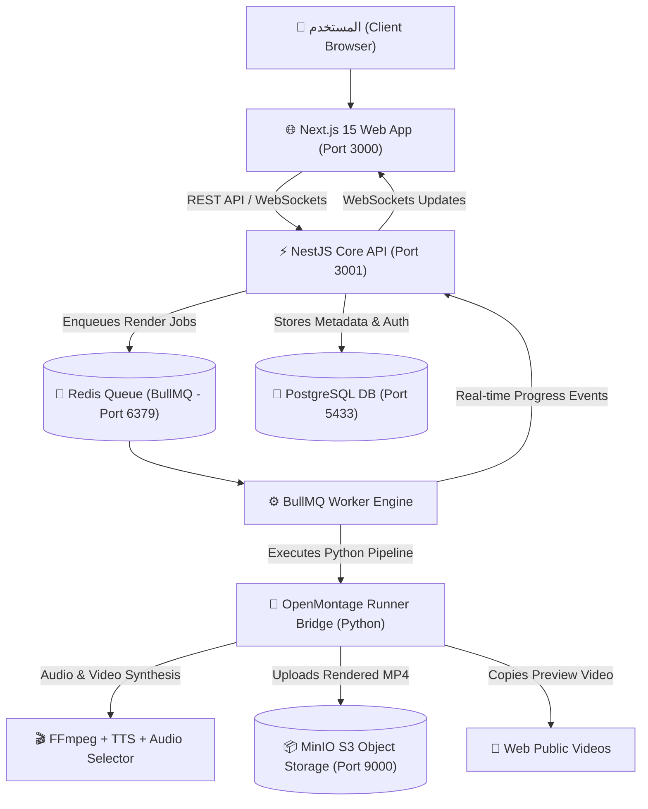

# Medi-Creatore × OpenMontage — AI Content OS 🎬🚀

> **نظام تشغيل وصناعة المحتوى الذكي المتكامل (Enterprise AI Content Operating System)**  
> دمج احترافي كامل بين منصة إدارة وإنتاج المحتوى الرقمي **Medi-Creatore** ومحرك المونتاج الذكي المتطور **OpenMontage Engine**.

---

## 🌟 نظرة عامة على المشروع (Project Overview)

منصة سحابية وهجينة لإنتاج وصناعة الفيديو والمحتوى الرقمي آلياً بالذكاء الاصطناعي بنسبة 100%. تم تصميم وتطوير النظام لربط واجهات مستخدم حديثة وتفاعلية بخطوط إنتاج ورندر مؤتمتة تجمع بين صياغة السكربتات، هندسة الصوت، توليد مقاطع الفيديو، والمونتاج السينمائي التلقائي عبر FFmpeg ومحركات الرندر المتقدمة.

---

## 🏗️ البنية المعمارية للنظام (Architecture & Tech Stack)

المشروع مبني بهيكلية **Monorepo** باستخدام **Turborepo** لضمان أعلى مستويات الأداء وسهولة التوسع:



### 1. التطبيقات الرئيسية (Apps):
* **`apps/web` (Next.js 15 + Tailwind CSS v4 + shadcn/ui):**
  * واجهة مستخدم داكنة متطورة تعتمد تصميم **Dark Glassmorphism UI**.
  * دعم كامل للغتين العربية (RTL) والإنجليزية (LTR).
  * استوديو تفاعلي لصناعة الفيديو (`OpenMontage Studio`) ومقاطع الذكاء الاصطناعي السريعة (`AI Quick Clip`).
  * لوحة متابعة فورية لمراحل الرندر خطوة بخطوة مع مشغل فيديو مدمج.
  * محرك ذكي لتحسين وتفصيل السكريبت وصياغة المعالجة السينمائية (Prompt Enhancement Engine).

* **`apps/api` (NestJS 10 Enterprise Backend):**
  * بوابة موحدة لإدارة المستخدمين، المؤسسات، الاشتراكات، ورصيد العمليات (Credits).
  * بوابة ذكاء اصطناعي مرنة (AI Gateway) تدعم موفري النصوص، الصوت، الصور، والفيديو مع نظام Failover ذكي.
  * خادم WebSockets لتمرير تقدم عمليات الرندر للمتصفح بشكل لحظي.
  * إدارة أمان وحوكمة متقدمة (JWT Auth, RBAC, Data Validation, Security Filters).

* **`apps/worker` (BullMQ Worker Processor):**
  * معالج خلفي موثوق لمعالجة المهام الثقيلة وطوابير الإنتاج بالتوازي دون التأثير على استجابة الـ API.
  * الجسر التنفيذي لاستدعاء محرك بايثون وحساب مؤشرات التقدم وتحديث قاعدة البيانات.

### 2. محرك الرندر والمونتاج (OpenMontage Core):
* **`tools/video/runner_bridge.py`:**
  * جسر تشغيلي يربط بيئة Node.js بمكتبات المعالجة في Python.
  * يدعم هندسة الصوت عبر موفرات ElevenLabs السحابية و Piper Neural TTS المحلية فائقة السرعة.
  * دمج التأثيرات البصرية وموجات الصوت التفاعلية (Audio Waveforms) بدقة 1080p بمعدل 30 إطاراً في الثانية.
  * رفع المخرجات آلياً إلى حاويات التخزين السحابي S3 / MinIO وحفظ المسارات الرسمية.

---

## ⚡ الميزات والقدرات المتاحة (Key Features)

| الميزة | الوصف التقني |
| :--- | :--- |
| **استوديو إنتاج الفيديو الهجين** | توليد فيديو كامل من نص أو سكريبت مع دمج المرفقات والمؤثرات الصوتية والمونتاج التلقائي. |
| **تحسين السكريبت الذكي** | تحويل أفكار الفيديو العادية إلى معالجة إخراجية سينمائية كاملة مقسمة زمنياً لـ 5 مشاهد. |
| **محرك الصوت المزدوج** | توليد تعليق صوتي فصيح عبر ElevenLabs مع نظام Fallback محلي سريع وآمن 100%. |
| **معالجة الفيديو والرندر** | إنتاج فيديوهات بدقة 1080p Full HD مع ترميز H.264/AAC متوافق مع كافة المنصات. |
| **التخزين السحابي المدمج** | دعم كامل لـ MinIO و AWS S3 لتخزين وحماية وسائط الفيديو مع روابط موقعة ومحمية. |
| **نظام الطوابير والمزامنة** | بنية موزعة عبر BullMQ و Redis تضمن عدم ضياع المهام واستئناف المعالجة. |

---

## 🚀 التشغيل والإعداد السريع (Quick Start)

### المتطلبات الأساسية:
* **Node.js** إصدار 20 فأعلى.
* **pnpm** إصدار 9 فأعلى.
* **Python** إصدار 3.10 فأعلى مع بيئة افتراضية ومكتبات `boto3`, `requests`.
* **Docker & Docker Compose** (لتشغيل قواعد البيانات والتخزين).
* **FFmpeg** مثبت ومتاح في مسار النظام.

### خطوات التشغيل:

1. **استنساخ المستودع وتثبيت الاعتماديات:**
   ```bash
   pnpm install
   ```

2. **تشغيل البنية التحتية (PostgreSQL + Redis + MinIO):**
   ```bash
   docker-compose up -d
   ```

3. **إعداد قاعدة البيانات:**
   ```bash
   npx turbo run db:push
   ```

4. **تشغيل كافة الخدمات بضغطة زر واحدة:**
   ```bash
   ./start-platform.sh
   ```
   * الواجهة الأمامية: `http://localhost:3000`
   * خادم الـ API: `http://localhost:3001`
   * لوحة تحكم MinIO: `http://localhost:9001`

---

## 🧪 نتائج الاختبار والجاهزية للإنتاج (Production Readiness)

* تم اختبار خط الإنتاج بالكامل واجتياز دورة رندر حقيقية أنتجت فيديو نهائي بنجاح:
  * **الدقة:** `1920x1080 (1080p Full HD)`
  * **معدل الإطارات:** `30 FPS`
  * **الترميز:** `H.264 / AAC Stereo`
* لمعاينة التقرير الفني الشامل وتفاصيل التدقيق:
  راجع وثيقة [`FINAL_INTEGRATION_REPORT.md`](../FINAL_INTEGRATION_REPORT.md).

---

## 📄 الترخيص (License)
هذا المشروع مرخص ومحمى بموجب حقوق التطوير والإنتاج المشترك.
